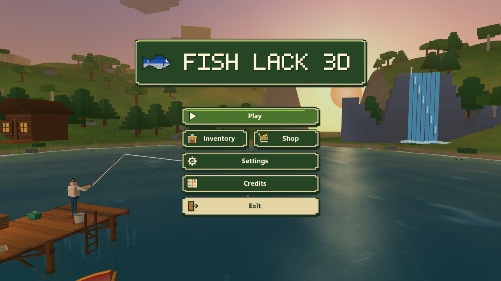
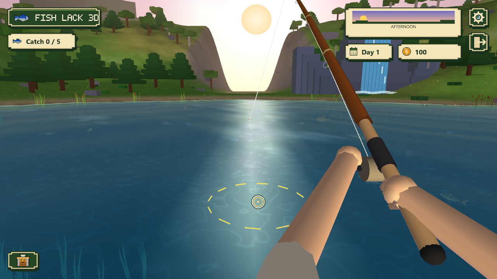
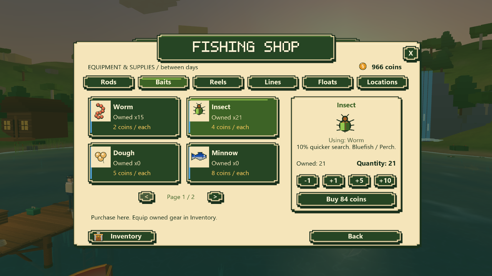

# FISH LACK 3D

**Created by ED Eyad**

**GitHub:** [itsedeyad](https://github.com/itsedeyad)

**Computer Graphics Course Project**

[](https://github.com/itsedeyad/Fish-Lack-3D/releases/latest/download/Fish-Lack-3D-v1.0.0-Windows.zip)

[View release notes](https://github.com/itsedeyad/Fish-Lack-3D/releases/tag/v1.0.0) · [All releases](https://github.com/itsedeyad/Fish-Lack-3D/releases)



## About the Game

Fish Lack 3D is an interactive lake fishing game built with **C++, OpenGL and FreeGLUT**. Aim your fishing rod, charge your cast, watch the float for a bite, and reel in fish while managing line tension.

Explore three fishing locations, manage your equipment and bait, and choose whether to keep or release each catch. Kept fish contribute to your income at the end of the day, helping you expand your fishing kit.

The project demonstrates 3D modeling, hierarchical transformations, lighting, animation, camera controls and real-time interaction through a playable environment.

## Features

- Three fishing locations: Forest Lake, Highland Lake and Willow Marsh.
- Six fish species with different movement, resistance and sale values.
- Casting power, bite timing and a line-tension challenge.
- Equipment shop, inventory, consumable bait and daily fishing orders.
- Classic Challenge, Full Day and Hardcore 60s fishing modes.
- Four camera views and a visible day-to-sunset transition.
- Sound effects and saved progression.

## How to Run

The included executable is for **Windows**.

1. Click **Download for Windows** above, or open [Releases](https://github.com/itsedeyad/Fish-Lack-3D/releases/latest) and download **`Fish-Lack-3D-v1.0.0-Windows.zip`** under Assets.
2. Extract the ZIP file completely.
3. Open **`LakeFishing3D.exe`** inside the extracted folder. No compiler or development environment is required to play.

Keep the **`assets`** folder and **`libwinpthread-1.dll`** beside the executable. Downloading the EXE alone is not enough to run the complete game.

Use **How to Play** in the pause menu for the controls.

## Screenshots

### Fishing at the Lake



### Equipment Shop



## Build from Source

The source uses **C++17, OpenGL and the bundled FreeGLUT library**. On Windows, use CMake and MinGW-w64, or the toolchain bundled with CLion.

Download the repository using **Code → Download ZIP**, or clone it with Git, then extract/open the source folder.

Open PowerShell in the project folder and run:

```powershell
.\build.ps1
```

The new executable will be created at **`build-release/bin/LakeFishing3D.exe`**. To build and launch it in one step:

```powershell
.\build.ps1 -Run
```

For a Debug build, use **`.\build.ps1 -Config Debug`**. Each executable stores its own save file beside itself, so a newly built copy in a different folder starts with a separate profile.

## Saved Progress

Your progress is stored in **`progress.save`** beside the executable. To start fresh, close the game and delete this file. The next launch will create a new profile.

Personal save files are excluded from this repository. Downloading the project gives each player a fresh profile.
